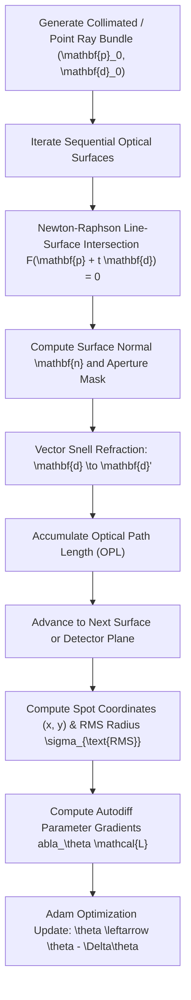

# DiffOptics

[](https://github.com/ZengLLQ/diff-optics/actions)
[](https://www.python.org/downloads/)
[](https://opensource.org/licenses/MIT)

**DiffOptics** is a scientific differentiable ray tracing and computational lens optimization engine implemented in pure Python. It combines 3D vector geometric optics, exact Newton-Raphson aspheric surface intersection, 3D Snell's law refraction, and gradient-based automatic differentiation to eliminate geometric aberrations and optimize optical designs towards diffraction limits.

---

## Mathematical & Optical Formulation

### 1. Even Aspheric Surface Equation
The sag $z(r)$ of an aspheric optical surface as a function of radial coordinate $r = \sqrt{x^2 + y^2}$ is defined as:

$$
z(r) = \frac{c r^2}{1 + \sqrt{1 - (1 + k) c^2 r^2}} + \alpha_4 r^4 + \alpha_6 r^6
$$

Where:
- $c = \frac{1}{R}$ is the base vertex curvature (reciprocal of radius of curvature $R$).
- $k$ is the conic constant:
  - $k = 0$: Spherical surface
  - $k = -1$: Parabolic surface
  - $k < -1$: Hyperbolic surface
  - $-1 < k < 0$: Elliptic surface
- $\alpha_4, \alpha_6$ are higher-order even aspheric deformation coefficients.

The inward surface normal unit vector $\mathbf{n}$ is obtained from the gradient of the implicit surface $F(x, y, z) = z - z_{\text{vertex}} - z_{\text{sag}}(x, y) = 0$:

$$
\mathbf{n} = \frac{\left( -\frac{\partial z}{\partial x}, -\frac{\partial z}{\partial y}, 1 \right)}{\sqrt{\left(\frac{\partial z}{\partial x}\right)^2 + \left(\frac{\partial z}{\partial y}\right)^2 + 1}}
$$

---

### 2. 3D Vector Snell's Law of Refraction
Let $\mathbf{d}$ be the incident ray unit vector and $\mathbf{n}$ be the surface normal oriented to oppose $\mathbf{d}$ ($\mathbf{d} \cdot \mathbf{n} \le 0$). With relative refractive index $\eta = \frac{n_1}{n_2}$:

$$
\cos\theta_1 = -(\mathbf{d} \cdot \mathbf{n})
$$

$$
\cos\theta_2 = \sqrt{1 - \eta^2 (1 - \cos^2\theta_1)}
$$

The refracted ray direction $\mathbf{d}'$ is:

$$
\mathbf{d}' = \eta \mathbf{d} + (\eta \cos\theta_1 - \cos\theta_2) \mathbf{n}
$$

Total Internal Reflection (TIR) occurs when $1 - \eta^2 (1 - \cos^2\theta_1) < 0$.

---

### 3. Differentiable Merit Function & Gradient Optimization
Optical aberrations are quantified via the Root-Mean-Square (RMS) spot radius on the detector plane:

$$
\mathcal{L}(\theta) = \sigma_{\text{RMS}} = \sqrt{\frac{1}{K} \sum_{k=1}^K \left[ (x_k - \bar{x})^2 + (y_k - \bar{y})^2 \right]}
$$

Where parameter vector $\theta = (c_1, k_1, c_2, \dots)$ is iteratively updated via Adam gradient descent:

$$
\theta^{(t+1)} = \theta^{(t)} - \frac{\alpha}{\sqrt{\hat{v}_t} + \epsilon} \hat{m}_t
$$

---

## Differentiable Ray Tracing Architecture



---

## Installation

```bash
# Clone the repository
git clone https://github.com/ZengLLQ/diff-optics.git
cd diff-optics

# Install package
pip install -e .
```

---

## CLI Simulation Commands

### 1. Trace Singlet Lens
```bash
diffoptics trace --curvature 0.02 --thickness 5.0 --focal-dist 100.0
```

### 2. Optimize Aspheric Lens Shape
```bash
diffoptics optimize --iterations 30 --lr 0.05
```

---

## Python API Usage

```python
import numpy as np
from diffoptics import RayBundle, OpticalSurface, OpticalSystem, LensOptimizer

# 1. Assemble optical system
s1 = OpticalSurface(z_position=0.0, curvature=0.025, conic=0.0, refractive_index=1.5168)
s2 = OpticalSurface(z_position=5.0, curvature=0.0, refractive_index=1.0)
system = OpticalSystem(surfaces=[s1, s2], z_image=85.0)

# 2. Trace collimated beam
rays = RayBundle.create_collimated_bundle(radius=8.0, num_rings=4)
system.trace(rays)
rms_init = system.compute_rms_spot_radius(rays)
print(f"Initial RMS Spot: {rms_init:.4f} mm")

# 3. Optimize conic constant using Adam gradient descent
opt = LensOptimizer(system, lambda: RayBundle.create_collimated_bundle(8.0, 4), [(0, "conic")])
opt_params, _ = opt.optimize_adam(learning_rate=0.05, iterations=20)
print(f"Optimized Conic: {opt_params[0]:.4f}")
```

---

## Test Suite

Run the full pytest suite:

```bash
pytest -v
```

---

## License

This software is released under the [MIT License](LICENSE).
